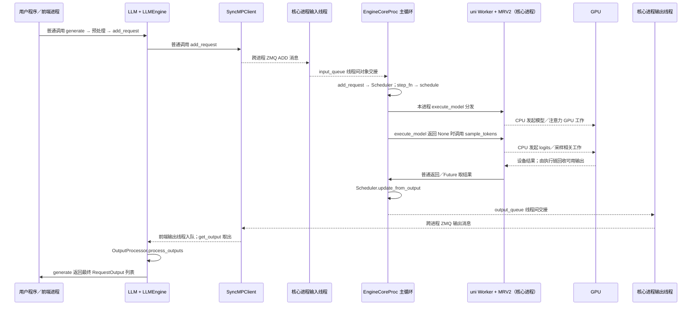

# 第一章：仓库地图与最小运行示例

固定 commit：`f9c98bd1ebbddb9acedb1e6d7505ad9588f9a266`。环境与约束见 [首页](../README.md)，实际执行记录见 [checks.md](../checks.md)。本章只建立单 GPU 文本生成的导航，不要求现在读完所有核心模块。

## 1. 本章要回答的问题

1. 从 `from vllm import LLM` 开始，实际使用哪个引擎实现？
2. 已知 Scheduler、Block Manager 和 Model Runner，应该从哪些目录进入 vLLM？
3. 单 GPU 为什么仍可能有进程通信？哪些看似 RPC 的调用实际留在同一进程？
4. 一个最小生成程序需要哪些前置条件？当前工作区具备哪些条件？
5. 如何验证自己读到的是当前分支的真实调用链，而非旧版架构图？

## 2. 先建立直观理解

把生成一次补全文本看成“提交任务—安排工作—执行计算—整理结果”。输入一句 `The capital of France is`，调用方首先交给用户入口 `LLM`；输入处理把文本变成 token ID，引擎核心安排本轮要计算的 token，设备侧运行模型，再把选出的 token 送回前端转成文本。

这里的**引擎核心（EngineCore）**负责组织计算，**执行器（Executor）**负责把计算交给 Worker，**模型执行器（Model Runner）**负责准备张量和运行模型。三者不是同一个对象。调度器只决定工作，不在 Python 调度循环里直接实现注意力内核。

**源码事实：**顶层 `LLM` 是延迟导入，映射到 `vllm.entrypoints.llm:LLM`，见 [vllm/__init__.py:16](../../vllm/__init__.py#L16) 的 `MODULE_ATTRS`。`LLM.__init__` 调用 `LLMEngine.from_engine_args`，见 [vllm/entrypoints/llm.py:343](../../vllm/entrypoints/llm.py#L343)。公开兼容入口直接把 `LLMEngine` 设为 V1 类别名，见 [vllm/engine/llm_engine.py:4](../../vllm/engine/llm_engine.py#L4)。因此本笔记不需要先讲一遍 V0 再“切换到 V1”。

**源码事实：**V1 架构内部又有两套 GPU Runner。`VllmConfig.use_v2_model_runner` 先看环境变量，再看 Triton 与不支持的特征；符合条件才默认返回 True，见 [vllm/config/vllm.py:653](../../vllm/config/vllm.py#L653)。Worker 根据这个值创建 MRV2 或 MRV1，见 [vllm/v1/worker/gpu_worker.py:463](../../vllm/v1/worker/gpu_worker.py#L463)。__Runner V1/V2 与引擎 V0/V1 是两条不同的版本维度。__

**设计解释：**先给每个模块确定职责，再读实现细节，会比从某个巨大的 GPU 文件逐行读起更容易。目录名、对象名和实际选择条件共同决定运行路径，单靠文件存在无法判断某个 Runner 已经被使用。

### 本章的教学配置与默认配置

附带的最小脚本使用：单 GPU、`tensor_parallel_size=1`、`distributed_executor_backend="uni"`、`async_scheduling=False`、`enforce_eager=True`、`enable_prefix_caching=False`，不启用投机解码、多模态和 LoRA。运行命令显式设置 `VLLM_USE_V2_MODEL_RUNNER=1`，从而固定阅读分支；这不是宣称任意模型和配置都支持 MRV2。

`VLLM_ENABLE_V1_MULTIPROCESSING=1` 保留前端与核心进程分离。默认值也是 1，证据见 [vllm/envs.py:1408](../../vllm/envs.py#L1408)。这与 `uni` 不矛盾：前者控制前端和核心之间的边界，后者控制核心如何执行 Worker。

关闭异步调度是教学选择。本版符合条件时会默认开启异步调度，见 [vllm/config/vllm.py:1270](../../vllm/config/vllm.py#L1270)。显式 False 时，默认 Scheduler 类选择同步实现，见 [vllm/config/scheduler.py:201](../../vllm/config/scheduler.py#L201)。关闭图执行只简化 CPU 发起计算的路径，计算依然使用 GPU；本章设置不作为性能基线推荐。

## 3. 与 nano-vLLM 的对应关系

工作区检索没有发现可用于对照的 nano-vLLM 源码。本节只比较你已经掌握的概念，不给 nano-vLLM 编造路径或符号。

| 已有概念 | 在本仓库先找什么 | 哪些不能直接照搬 |
| --- | --- | --- |
| Scheduler | `vllm/v1/core/sched/scheduler.py` 的 `Scheduler` | 不应预设两个独立 prefill/decode 阶段；源码统一以 token 进度描述调度 |
| Block Manager | `kv_cache_manager.py`、`block_pool.py` | 是分层协作，不保证一个管理器就包含分配、缓存命中、所有表更新 |
| Model Runner | `vllm/v1/worker/gpu/model_runner.py` | 先确认 MRV2 分支；不要把同目录外的 MRV1 方法拼进来 |
| 简化引擎循环 | `LLMEngine`、`EngineCoreClient`、`EngineCore` | 前端的 step 可是在等输出；核心循环才调度和执行；不是一条普通调用栈 |
| Sequence | V1 的 `Request` 与前端输出状态 | 暂不把旧教程的 Sequence/SequenceGroup 当作这里的主状态对象 |

调度抽象的源码证据在 [vllm/v1/core/sched/scheduler.py:535](../../vllm/v1/core/sched/scheduler.py#L535) 的 `Scheduler.schedule`：注释明确围绕 `num_computed_tokens` 与 `num_tokens_with_spec` 组织工作。这里只建立入口，第四章再核对具体预算与扣减。

## 4. 源码阅读地图

### 目录按职责看

| 目录 | 现在用它回答什么 | 本章阅读深度 |
| --- | --- | --- |
| `examples/basic/offline_inference/` | 用户最少怎么调用生成 API？ | 读 `basic.py` |
| `vllm/entrypoints/` | 对外 API 如何组织输入与最终结果？ | 读 LLM 与 offline mixin |
| `vllm/engine/` | 公开兼容路径最后导向哪里？ | 检查别名，不假定是 V0 |
| `vllm/v1/engine/` | 前端、client、核心如何分工？ | 找建连、提交、step、输出处理 |
| `vllm/v1/core/` | 调度与 KV 资源如何管理？ | 找类与主方法，不展开分配算法 |
| `vllm/v1/executor/`、`worker/` | 谁加载模型、谁真正执行？ | 读 uni 分支与 Runner 选择 |
| `vllm/model_executor/` | 选中的模型、层和权重加载在哪里？ | 只定位本例 OPT 模型 |
| `vllm/v1/attention/`、`csrc/` | 后端和底层实现在哪里？ | 作为第六章路标，暂不逐一展开 |
| `tests/v1/`、`tests/evals/` | 未来修改如何证明正确？ | 看已有测试入口与前置依赖 |
| `benchmarks/`、`vllm/benchmarks/` | 实验和 benchmark 实现在哪里？ | 第十章细读；内核微基准在 `benchmarks/kernels/` |

### 按顺序阅读符号

表内行号固定到本笔记 commit；每项说明阅读目的，而不是要求读完整文件。

| 顺序 | 位置与符号 | 为什么读 |
| --- | --- | --- |
| 1 | [examples/basic/offline_inference/basic.py:17](../../examples/basic/offline_inference/basic.py#L17)，`main` | 对齐 LLM、SamplingParams 和 RequestOutput 的用户契约 |
| 2 | [vllm/entrypoints/llm.py:418](../../vllm/entrypoints/llm.py#L418)，`LLM.generate` | 看生成入口如何委托 mixin；初始化回看第 343 行 |
| 3 | [vllm/entrypoints/offline_utils.py:334](../../vllm/entrypoints/offline_utils.py#L334)，`OfflineInferenceMixin._run_completion` | 区分先加请求与后收结果 |
| 4 | [vllm/entrypoints/offline_utils.py:110](../../vllm/entrypoints/offline_utils.py#L110)，`_preprocess_cmpl`；[vllm/renderers/base.py:1105](../../vllm/renderers/base.py#L1105)，`BaseRenderer.render_cmpl` | 定位文本输入的渲染与 tokenization 路线，第二章深入 |
| 5 | [vllm/v1/engine/llm_engine.py:223](../../vllm/v1/engine/llm_engine.py#L223)，`LLMEngine.add_request`；[vllm/v1/engine/input_processor.py:281](../../vllm/v1/engine/input_processor.py#L281)，`InputProcessor.process_inputs` | 找前端校验、消息构造与输出状态注册 |
| 6 | [vllm/v1/engine/core_client.py:91](../../vllm/v1/engine/core_client.py#L91)，`EngineCoreClient.make_client`；第 976 行 `SyncMPClient.add_request` | 看所选 client 如何把 ADD 请求送到核心 |
| 7 | [vllm/v1/engine/core.py:1705](../../vllm/v1/engine/core.py#L1705)，`EngineCoreProc.process_input_sockets`；第 1422 行 `run_busy_loop` | 跨过 socket 和线程队列后，才进入核心循环 |
| 8 | [vllm/v1/engine/core.py:608](../../vllm/v1/engine/core.py#L608)，`EngineCore.step` | 最短的调度→执行→状态更新骨架 |
| 9 | [vllm/v1/core/sched/scheduler.py:535](../../vllm/v1/core/sched/scheduler.py#L535)，`Scheduler.schedule`；第 1837 行 `update_from_output` | 找每轮工作计划与结果消费；不是本章就读完这两个大方法 |
| 10 | [vllm/v1/core/kv_cache_manager.py:118](../../vllm/v1/core/kv_cache_manager.py#L118)，`KVCacheManager` | 给第五章的 KV 管理建立入口 |
| 11 | [vllm/v1/executor/uniproc_executor.py:119](../../vllm/v1/executor/uniproc_executor.py#L119)，`UniProcExecutor.execute_model`；第 90 行 `collective_rpc` | 确认 uni 下是本进程分发，方法名有 RPC 不代表一定 IPC |
| 12 | [vllm/v1/worker/gpu_worker.py:1117](../../vllm/v1/worker/gpu_worker.py#L1117)，`Worker.execute_model`；第 1178 行 Runner 调用 | 穿过设备工作对象，找到实际模型执行器 |
| 13 | [vllm/v1/worker/gpu/model_runner.py:1563](../../vllm/v1/worker/gpu/model_runner.py#L1563)，`GPUModelRunner.execute_model`；第 1896 行 `sample_tokens` | 看前向与采样是两个入口；第 1849 行是本例 eager 分支的模型调用 |
| 14 | [vllm/v1/engine/output_processor.py:622](../../vllm/v1/engine/output_processor.py#L622)，`OutputProcessor.process_outputs`；[vllm/outputs.py:106](../../vllm/outputs.py#L106)，`RequestOutput` | 找内部 token 输出如何整理为用户输出 |

分支路标：MRV1 的执行入口是 [vllm/v1/worker/gpu_model_runner.py:4274](../../vllm/v1/worker/gpu_model_runner.py#L4274)，本章主链不进入它。在线服务 CLI 在 [vllm/entrypoints/cli/serve.py:45](../../vllm/entrypoints/cli/serve.py#L45) 的 `ServeSubcommand`，异步接口在 [vllm/v1/engine/async_llm.py:77](../../vllm/v1/engine/async_llm.py#L77) 的 `AsyncLLM`；暂不把 HTTP 服务器加进离线最小案例。

## 5. 真实调用链：保留通信边界

以下是对源码分支的简化导航图，不是实际采集的 trace。限定为本章教学配置，省略启动握手、监控和错误路径。实线标普通 CPU 函数调用；虚线的文字明确说明消息、队列或 GPU 工作，不能一概当成函数调用。



图中的 GPU 线表示设备工作，不表示调用一次 Python 函数就立刻同步等到 GPU 结束。某些输入准备也会发起 GPU 工作；完整流、事件和回收时机留到第六、七章。

把图还原为可定位的边：

- __普通调用（前端）__：`LLM.generate` → `_run_completion` → `_add_completion_requests` → `_render_and_add_requests` → `_add_request` → `LLMEngine.add_request`。文本渲染由 `_preprocess_cmpl` 提供；`_run_completion` 随后调用 `_run_engine` 收结果。
- __跨进程消息__：`SyncMPClient.add_request` → `_send_input` → `input_socket.send_multipart`，见 [vllm/v1/engine/core_client.py:956](../../vllm/v1/engine/core_client.py#L956)。不是直接调用另一个进程中的 `EngineCore.add_request`。
- __线程队列__：`process_input_sockets` 收消息、反序列化并预处理后放入 `input_queue`，见 [vllm/v1/engine/core.py:1765](../../vllm/v1/engine/core.py#L1765)。`run_busy_loop` 经 `_process_input_queue` 和 `_handle_client_request` 分发 ADD，后者见 [vllm/v1/engine/core.py:1551](../../vllm/v1/engine/core.py#L1551)。这里不宣称文本 token ID 必然走共享内存。
- __普通调用（核心）__：核心 `step_fn` 按是否启用 batch queue 选择实现，见 [vllm/v1/engine/core.py:235](../../vllm/v1/engine/core.py#L235)。本例关闭异步且 PP=1，`VllmConfig.max_concurrent_batches` 为 1，见 [vllm/config/vllm.py:567](../../vllm/config/vllm.py#L567)，因此进入 `EngineCore.step`。
- __普通调用→设备执行__：`UniProcExecutor.execute_model` → `collective_rpc` → `run_method(driver_worker, ...)` → Worker → MRV2。`UniProcExecutor._init_executor` 在同进程创建 `WorkerWrapperBase`，见 [vllm/v1/executor/uniproc_executor.py:52](../../vllm/v1/executor/uniproc_executor.py#L52)。本例没有额外 Worker 进程。
- __结果返回__：核心 `_process_engine_step` 把结果放到 `output_queue`，见 [vllm/v1/engine/core.py:1479](../../vllm/v1/engine/core.py#L1479)；`process_output_sockets` 发回消息，入口见 [vllm/v1/engine/core.py:1808](../../vllm/v1/engine/core.py#L1808)。`SyncMPClient.get_output` 从前端队列取结果，见 [vllm/v1/engine/core_client.py:944](../../vllm/v1/engine/core_client.py#L944)。前端 `LLMEngine.step` 再加工输出。

如果显式设 `VLLM_ENABLE_V1_MULTIPROCESSING=0`，本例会走 `InprocClient`。它的 `get_output` 直接调用核心 `step_fn`，见 [vllm/v1/engine/core_client.py:361](../../vllm/v1/engine/core_client.py#L361)。这可以辅助调试，但不替代上述默认多进程边界。本轮未运行这两个分支。

## 6. 关键源码精读

以下均为固定 commit 的原代码小段，仅去掉外围缩进；每段之前的 source 标记供附带脚本逐字核验。不将伪代码混入真实摘录。

### 6.1 离线请求明确只取最终结果

`OfflineInferenceMixin._add_request`，见 [vllm/entrypoints/offline_utils.py:567](../../vllm/entrypoints/offline_utils.py#L567)。

<!-- source: vllm/entrypoints/offline_utils.py:567-579 -->

```python
if isinstance(params, SamplingParams):
    # We only care about the final output
    params.output_kind = RequestOutputKind.FINAL_ONLY

request_id = str(next(self.request_counter))

return self.llm_engine.add_request(
    request_id,
    prompt,
    params,
    lora_request=lora_request,
    priority=priority,
)
```

输入是已经渲染为 `EngineInput` 的 prompt 和生成参数；输出是请求 ID。它修改 `params.output_kind`，推进前端 `request_counter`，然后交给引擎。**设计解释：**离线调用需要完整结果，这使后续输出链可以只对外产出最终 completion；不代表内部只执行一个 step。请求 ID 还会经过 `InputProcessor.assign_request_id`，入口见 [vllm/v1/engine/input_processor.py:262](../../vllm/v1/engine/input_processor.py#L262)，不要把这里产生的字符串直接当作永远不变的内部 ID。

### 6.2 一个 completion 同时注册输出状态与核心工作

`LLMEngine.add_request` 的 `n == 1` 分支，见 [vllm/v1/engine/llm_engine.py:280](../../vllm/v1/engine/llm_engine.py#L280)。

<!-- source: vllm/v1/engine/llm_engine.py:280-285 -->

```python
if n == 1:
    # Make a new RequestState and queue.
    self.output_processor.add_request(request, prompt_text, None, 0)
    # Add the request to EngineCore.
    self.engine_core.add_request(request)
    return req_id
```

这里 `request` 已是前端构造的核心请求消息；返回 `req_id`。状态分成两处：输出处理器登记如何把后续 token 对应回请求，核心 client 接收计算任务。**设计解释：**只理解 Scheduler 的请求表还不够，前端也必须知道怎样解释返回结果。`self.engine_core` 在这里是 client 对象；成员名不能作为“同进程核心对象”的证据。`n > 1` 的父子请求本章不展开。

### 6.3 核心循环调度后，可能还需单独采样

`EngineCore.step`，见 [vllm/v1/engine/core.py:619](../../vllm/v1/engine/core.py#L619)。

<!-- source: vllm/v1/engine/core.py:619-628 -->

```python
scheduler_output = self.scheduler.schedule(self._should_throttle_prefills())
future = self.model_executor.execute_model(scheduler_output, non_block=True)
grammar_output = self.scheduler.get_grammar_bitmask(scheduler_output)
with (
    self.capture_iteration_details(scheduler_output) as iteration_details,
    self.log_error_detail(scheduler_output),
):
    model_output = future.result()
    if model_output is None:
        model_output = self.model_executor.sample_tokens(grammar_output)
```

输入主要来自 Scheduler 已登记的请求状态；`scheduler_output` 描述本轮计划，`model_output` 是执行/采样后的内部结果。`schedule` 会更新调度状态，并非纯函数。执行器返回 Future 供核心取得结果，不能仅从 `non_block=True` 推断存在新线程或新 Worker 进程：uni 实现还可能先执行方法、再把结果装入已完成 Future。

这段之后核心会先处理期间到来的 abort，再调用 `Scheduler.update_from_output`，见 [vllm/v1/engine/core.py:630](../../vllm/v1/engine/core.py#L630)。执行结果会影响下一轮状态和前端输出。**设计解释：**把计划、执行和结果消费分开，便于后续异步重叠；这段代码本身不是异步性能收益的证明。

### 6.4 本例 eager 分支真正调用模型

MRV2 的 `GPUModelRunner.execute_model`，见 [vllm/v1/worker/gpu/model_runner.py:1847](../../vllm/v1/worker/gpu/model_runner.py#L1847)。

<!-- source: vllm/v1/worker/gpu/model_runner.py:1847-1849 -->

```python
else:
    # Eager (NONE): call the raw model directly.
    model_output = self.model(**model_inputs)
```

输入是 Runner 已组织的模型输入张量，处于 `set_forward_context` 建立的 attention 上下文内。输出在单 GPU、末级 PP rank 的普通生成路径里是 hidden states，随后保存执行中间状态，供 `sample_tokens` 使用；不等于已经完成 detokenization 的用户字符串。OPT 实例的模型类可定位到 [vllm/model_executor/models/opt.py:327](../../vllm/model_executor/models/opt.py#L327) 的 `OPTForCausalLM`。

**源码事实：**相邻分支分别调用 full graph replay 或 piecewise graph。**设计解释：**先固定 eager 路径，可以先把模型调用和资源状态读清楚；图回放、padding 与性能比较留到第八章。具体 attention kernel 未在本轮运行选定，不能把某个后端名称写成实测事实。

### 6.5 前端 step 的任务是接收并加工输出

`LLMEngine.step`，见 [vllm/v1/engine/llm_engine.py:310](../../vllm/v1/engine/llm_engine.py#L310)。

<!-- source: vllm/v1/engine/llm_engine.py:310-323 -->

```python
# 1) Get EngineCoreOutput from the EngineCore.
with record_function_or_nullcontext("llm_engine step: get_output"):
    outputs = self.engine_core.get_output()

# 2) Process EngineCoreOutputs.
with record_function_or_nullcontext("llm_engine step: process_outputs"):
    iteration_stats = (
        IterationStats() if self.log_stats and outputs.outputs else None
    )
    processed_outputs = self.output_processor.process_outputs(
        outputs.outputs,
        engine_core_timestamp=outputs.timestamp,
        iteration_stats=iteration_stats,
    )
```

输入是 client 提供的内部输出，输出加工结果保存在 `processed_outputs`；后续会处理因 stop string 结束而需通知核心 abort 的请求，并返回用户输出列表。`OutputProcessor` 更新前端请求状态、反分词和完成信息，不是在这里运行 GPU forward。离线 `_run_engine` 持续调用前端 step，并只收集 `finished` 的结果，见 [vllm/entrypoints/offline_utils.py:602](../../vllm/entrypoints/offline_utils.py#L602)。

## 7. 贯穿案例：四个输入 token，生成两个 token

**教学示例，非运行日志。**假设无 prefix 命中、无抢占、无提前 EOS、无 stop string、无投机，采用同步调度，prompt token ID 为 `[11, 22, 33, 44]`，目标输出最多 2 个 token。把内部请求统称为 `R`，不预测实际 ID。假定本例 block size 为 16、一个 KV cache group，分到的物理块号为 7；这些数字不代表后端默认值。

| 时刻 | 请求进度（概念值） | 本轮计划与结果 | KV 状态 |
| --- | --- | --- | --- |
| 提交后 | prompt 长 4，输出长 0，computed 为 0 | R 进入等待队列；尚无计算结果 | 尚未因本次调度分配 KV 块 |
| 第一轮计划 | computed 从 0 追到 4 | 预算充足时给 R 安排 4 个输入 token | 分配块 7，给 prompt 位置提供存储 |
| 第一轮回收 | prompt 长 4，输出长 1，computed 为 4 | 模型基于 prompt 选出教学 token 55 | prompt 四个位置的 KV 已计算；新选出的 55 尚未作为输入计算 |
| 第二轮计划 | 当前总 token 长 5，computed 为 4 | 给 R 安排 1 个 token，即 55 | 块 7 尚有空间，通常无需另分一块 |
| 第二轮回收 | 输出为 `[55, 66]`，computed 为 5 | 选出 66，达到 max_tokens=2，结束 | 66 无需再进入模型；不能说六个位置的 KV 都已算完 |
| 收尾 | 核心完成请求，前端输出 finished | 最终列表含一个 RequestOutput | 请求占用被释放；本例关闭 prefix cache，无须讨论缓存留存 |

这里的 computed 行是同步教学条件下的进度推演，不是“在模型返回时才统一加计数”的断言。实际 `Scheduler._update_after_schedule` 在调度后增加计数，见 [vllm/v1/core/sched/scheduler.py:1496](../../vllm/v1/core/sched/scheduler.py#L1496)；异步和投机下的预记账、回收修正要另读。

等待队列入口见 [vllm/v1/core/sched/scheduler.py:2424](../../vllm/v1/core/sched/scheduler.py#L2424) 的 `add_request`；资源回收入口见 [vllm/v1/core/sched/scheduler.py:2515](../../vllm/v1/core/sched/scheduler.py#L2515) 的 `_free_request`。完整分配和结束判定将在第三至五章精读，当前表只建立“被安排计算、已经生成、已有 KV”不是同一数量的直觉。

**设计解释：**第一轮给 4 个输入 token 做计算，普通自回归生成也通常只从请求末尾位置选一个下一 token；因此调度 token 数不能直接当成新增输出数。最后选出的 token 已足以返回给用户，不需要为了填满 KV 再额外 forward 一次。

## 8. 动手实验

### 8.1 当前已验证：源码导航与环境检查

Windows PowerShell，从仓库根目录执行，均不导入 vLLM：

```powershell
git rev-parse HEAD
git status --short
rg -n 'LLMEngine =|from_engine_args' vllm/engine/llm_engine.py vllm/entrypoints/llm.py
rg -n 'def schedule|def update_from_output' vllm/v1/core/sched/scheduler.py
rg -n 'use_v2_model_runner|GPUModelRunnerV2|GPUModelRunnerV1' vllm/v1/worker/gpu_worker.py
```

观察点：HEAD 与首页一致；状态应只包含自己理解的改动；兼容入口确实指向 V1；Worker 的两套 Runner 是条件分支。预期现象已由源码检索验证，无模型输出。

进入现有 Ubuntu 的登录 shell，再执行以下 Linux 命令，不在 PowerShell 中直接运行 `.venv/bin/python`：

```bash
cd /mnt/e/vllm
uv run --no-project --offline --python .venv/bin/python python learning_notes/tools/probe_environment.py
uv run --no-project --offline --python .venv/bin/python python learning_notes/tools/check_sources.py
```

前置条件：现有 WSL、uv、仓库虚拟环境。环境探测已运行；解释器可用，但推理依赖缺失。源码检查脚本只用标准库，检查 HEAD、链接目标、引用行号、摘录与部分关键符号锚点；它不能替代人工检查因果关系。

### 8.2 当前无法完成：仓库 CPU 测试

下面是已实际尝试的收集命令（只收集测试，不执行测试函数）：

```bash
uv run --no-project --offline --python .venv/bin/python python -m pytest tests/v1/core/test_scheduler.py --collect-only -q
```

结果：`No module named pytest`。测试函数没有运行，也没有成功收集；不要写成“Scheduler 单元测试通过”。缺少 pytest 只是已遇到的第一个阻碍，补齐后还可能缺少 Torch 和其他测试依赖。

仅供未来环境就绪后执行：

```bash
uv run --no-project --offline --python .venv/bin/python python -m pytest tests/v1/core/test_scheduler.py -q
```

该套测试的实际依赖应先阅读 `tests/conftest.py` 与测试自身 fixture；“不执行 GPU 推理的测试”也可能依赖 Torch 或编译扩展，不等于随便一个 Windows Python 都能跑。本轮不安装依赖。

替代练习：完成第七节的两轮状态表，并把每条边标成函数、IPC、线程队列或 GPU 工作；把 block size 从 16 改成教学值 4，说明第二轮为何可能需要额外块。此练习只检验理解，不替代自动测试。

### 8.3 仅提供步骤：最小 GPU 生成

前置条件：在固定 commit 下已有可用 vLLM 构建及匹配的 Torch/Triton/Transformers；Torch 能在 WSL 访问 GPU；已有本地完整 `facebook/opt-125m` 模型与 tokenizer 快照；模型必须支持所选 MRV2。这里不下载模型，不以显存容量推断构建兼容性或推理成功。

脚本是 [tools/minimal_generate.py](../tools/minimal_generate.py)。在 WSL 中把模型目录改为实际路径：

```bash
cd /mnt/e/vllm
export HF_HUB_OFFLINE=1
export VLLM_ENABLE_V1_MULTIPROCESSING=1
export VLLM_USE_V2_MODEL_RUNNER=1
uv run --no-project --offline --python .venv/bin/python python learning_notes/tools/minimal_generate.py --model /absolute/path/to/local/opt-125m
```

观察点：脚本打印实际 engine client、executor 配置、Runner 选择值和异步调度值；打印 `prompt_token_ids`、输出 `token_ids`、文本和 `finish_reason`。预期一个 prompt 对应一个完成的 RequestOutput，输出 token 数不超过 2；如果命中 EOS，可以少于 2。这里不规定具体文本和 token ID，不假设教学例子的 ID 与真实 tokenizer 一致。打印的 Runner 选择来自配置，不是假装跨进程读取了 Python 对象。

原仓库的用户示例在 `examples/basic/offline_inference/basic.py`，适合作为 API 对照；它未限制本地模型下载和生成长度，因此本章另附参数显式的学习脚本。仅新增笔记目录，不修改原示例。

### 8.4 仅提供步骤：验证后再采集 trace

先让无 profiler 的最小生成成功，再在同一 WSL shell 中执行：

```bash
nsys profile --trace=cuda,nvtx,osrt --output=learning_notes/minimal_trace \
  uv run --no-project --offline --python .venv/bin/python python \
  learning_notes/tools/minimal_generate.py --model /absolute/path/to/local/opt-125m
```

前置条件还包括 Nsight/CUPTI 的采集能力及对核心子进程 CUDA 活动的捕获支持。本轮只运行了 `nsys --version`，没运行这条采集命令。预期报告中可以区分 CPU 活动与 CUDA 工作；若没有核心子进程的 CUDA 活动，先查进程捕获与工具权限，不能认定模型没有执行。

这个短程序包含加载与 warmup，不能用报告总时长评价 decode 性能；它只用于认识进程和设备时间线。第十章另设预热、负载与测量窗口，比较低延迟与高吞吐场景。

## 9. 易错点与自我检验

先自己回答，再看本章最后的答案。

1. 看到 `vllm/engine/llm_engine.py`，为什么不能就认定它是 V0？如何用当前源码证明？
2. `distributed_executor_backend="uni"` 与 `VLLM_ENABLE_V1_MULTIPROCESSING=1` 能同时成立吗？Worker 在哪里？
3. 前端 `LLMEngine.step` 是否直接让 Scheduler 开始下一轮？在哪两个符号间能看到真实边界？
4. `execute_model(..., non_block=True)` 是否证明有一个独立 Worker 进程？该到哪里查？
5. 教学例子第一轮计算了四个 token，为什么只得到一个输出？结束时为什么没有 token 66 的 KV 也合理？
6. 找到 `gpu_model_runner.py` 和 `gpu/model_runner.py` 后，应查看哪个选择条件？它与 V0/V1 有什么关系？
7. `nvidia-smi` 和 `nsys --version` 成功，能否写“推理与性能分析已通过”？还缺什么证据？
8. `python -m pytest` 在导入 pytest 前失败，是否表明 Scheduler 实现有 bug？下一步先检查什么？

## 10. 本章总结

现在应能解释一次生成由入口、前端、通信、核心调度、执行和输出加工共同完成；能够区分前端 step 与核心 step，分清 V1 引擎和两套 Runner，并说明当前实验环境的具体缺口。

现在应能定位 LLM、offline mixin、V1 LLMEngine、EngineCoreClient、EngineCore、Scheduler、KVCacheManager、UniProcExecutor、GPU Worker、MRV2 与 OutputProcessor。尚未覆盖 tokenizer 的具体实现、Request 的完整生命周期、预算扣减、物理 KV 表、选中 attention backend、异步预记账和投机验证。

下一章沿用单 GPU、同步教学配置和请求 R，把本章的地图展开成端到端追踪：文本在哪里变成 token，消息对象在哪里变成核心 Request，谁选出 token，谁决定结束，谁将最终字符串返回调用者。先把这些边界连实，再研究具体调度策略。

### 自我检验答案

1. 看导入和赋值；兼容文件把 `LLMEngine` 设成 `vllm.v1.engine.llm_engine.LLMEngine` 的别名。路径名称不足以判断版本。
2. 能。前端与核心通过 ZMQ 分进程；核心内的 UniProcExecutor 直接持有 WorkerWrapperBase，Worker 在核心进程里。
3. MP client 下先取核心已产生的输出，并不直接调用 Scheduler。看 `LLMEngine.step` 的 `get_output` 和 `SyncMPClient.get_output` 的队列读取，再对照核心的 `run_busy_loop`。
4. 不能。看 `UniProcExecutor.collective_rpc`，它直接运行方法，再返回结果或 Future；是否额外进程由执行器实现决定。
5. 普通生成根据 prompt 末尾的预测选下一 token，计算输入数不是输出数。66 是最终新选出的 token，达到长度上限便可返回，不必再输入模型。
6. 看 `VllmConfig.use_v2_model_runner` 和 Worker 构造分支。两者都是 V1 架构内的 Runner，不是切到 V0。
7. 不能。还需 Torch CUDA、固定源码构建、模型推理成功、profiler 实际捕获设备活动；性能结论还需合理测量窗口、负载与对照。
8. 不能。先补齐或确认现有环境依赖，再收集测试，之后才谈测试行为。本轮只报告依赖缺失，不擅自安装。
