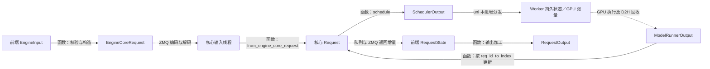

# 第三章：请求的多份状态与生命周期

固定源码 commit 沿用首页。前章已把流程接通；本章不重新讲入口，而是回答“改一个字段究竟影响谁”。主线仍是单 GPU、MRV2、同步、普通文本生成。

## 1. 本章要回答的问题

1. EngineCoreRequest、Request、RequestState 各自属于谁？
2. prompt、output、spec token 与 computed 之间有什么区别？
3. SchedulerOutput 与 ModelRunnerOutput 靠什么对齐？
4. finished、abort、preempt 为什么不能共用一种清理动作？

## 2. 先建立直观理解

一次网购可以同时有用户界面的订单、仓库的拣货单和运输消息。它们指向同一业务，但不能共用一个随意改写的对象。vLLM 请求也一样：前端关心文本、输出模式和外部 ID；核心关心调度进度和资源；Worker 关心设备状态与本轮输入。

**契约**指边界上双方共同遵守的数据含义。例如 `num_scheduled_tokens[R]=4` 是“这轮为 R 安排四个计算位置”，不是“这轮输出四个 token”。改调度策略前，必须保持这个含义。

## 3. 与 nano-vLLM 的对应关系

你可以把核心 Request 类比成简化推理器中的序列状态；但这里还存在消息 DTO、前端输出状态、Worker 持久张量行和每轮增量。DTO 意为“数据传输对象”，不是额外执行器。不要将某个 nano-vLLM 概念上的 Sequence 等同为所有这些对象。

## 4. 源码阅读地图

| 顺序 | 位置与符号 | 要确认的契约 |
| --- | --- | --- |
| 1 | [vllm/v1/engine/\_\_init\_\_.py:107](../../vllm/v1/engine/__init__.py#L107)，`EngineCoreRequest` | 跨进程输入携带 token、参数、ID、client_index 等，不携带 Scheduler 实例 |
| 2 | [vllm/v1/request.py:59](../../vllm/v1/request.py#L59)，`Request`；第 238 行 `from_engine_core_request` | 核心初始化与可变进度 |
| 3 | [vllm/v1/request.py:364](../../vllm/v1/request.py#L364)，`RequestStatus` | 等待、运行、抢占与各种终态 |
| 4 | [vllm/v1/core/sched/output.py:219](../../vllm/v1/core/sched/output.py#L219)，`SchedulerOutput` | 每轮计划、新请求全量和缓存请求增量 |
| 5 | [vllm/v1/outputs.py:320](../../vllm/v1/outputs.py#L320)，`ModelRunnerOutput` | 返回请求顺序、ID 到行号映射、每请求新 token |
| 6 | [vllm/v1/engine/\_\_init\_\_.py:196](../../vllm/v1/engine/__init__.py#L196)，`EngineCoreOutput` | 面向一个请求的内部增量结果 |
| 7 | [vllm/v1/engine/output_processor.py:132](../../vllm/v1/engine/output_processor.py#L132)，`RequestState` | 前端累计文本、反分词器、输出模式与 external ID |
| 8 | [vllm/v1/core/sched/scheduler.py:2515](../../vllm/v1/core/sched/scheduler.py#L2515)，`_free_request`；[vllm/v1/worker/gpu/model_runner.py:1026](../../vllm/v1/worker/gpu/model_runner.py#L1026)，`finish_requests` | 核心资源收尾与 Worker 持久状态收尾不是同一步 |

## 5. 真实调用链与状态所有权



这里的返回边表示“由核心状态和模型结果构造输出后传回”，不是把整个核心 Request 发回前端。图中 E→F 仅适用于 uni；多进程执行器会增加另一层通信。

| 数据 | 持有者／生命期 | 谁修改，谁消费 |
| --- | --- | --- |
| EngineCoreRequest | 提交边界上的消息 | 前端处理后交核心输入线程；内部 ID 分配发生在发送前 |
| Request | 核心 Scheduler 请求表 | 调度、模型结果回收、终止／抢占路径修改 |
| RequestState | 前端 OutputProcessor 请求表 | 消费返回的 token，累计文本并决定用户输出 |
| SchedulerOutput | 一轮计划快照及元数据 | Scheduler 产生；Worker 和结果回收逻辑共同使用 |
| ModelRunnerOutput | 一轮已回收的模型结果 | Worker 执行链产生；Scheduler 按 ID 映射消费 |

## 6. 关键源码精读

### 6.1 追加 token 并不会自动代表 KV 已经计算

`Request.append_output_token_ids`：

<!-- source: vllm/v1/request.py:269-276 -->

```python
if isinstance(token_ids, int):
    self._output_token_ids.append(token_ids)
    self._all_token_ids.append(token_ids)
else:
    self._output_token_ids.extend(token_ids)
    self._all_token_ids.extend(token_ids)

self.update_block_hashes()
```

输入是一个或多个已选定输出 token；无返回值。它同时更新输出列表与 prompt+output 的全集，并推进可计算的 block hash。没有在这里写 GPU KV，也没有增加 `num_computed_tokens`。hash 可以根据已知 token 计算，不等于对应 KV 已经就绪。

### 6.2 两个长度属性对应不同的 token 集合

<!-- source: vllm/v1/request.py:287-293 -->

```python
@property
def num_tokens(self) -> int:
    return len(self._all_token_ids)

@property
def num_tokens_with_spec(self) -> int:
    return len(self._all_token_ids) + len(self.spec_token_ids)
```

`num_tokens` 包含 prompt 与已提交输出；`num_tokens_with_spec` 再加候选 token。computed 是独立字段。没有投机、没有异步、一次普通 decode 结果回收后，常见关系是 `num_tokens = num_computed_tokens + 1`；这只描述此条件下的下一 token 尚未输入模型，不能提升为所有路径的不变量。

### 6.3 调度时预记账

`Scheduler._update_after_schedule`，见 [vllm/v1/core/sched/scheduler.py:1483](../../vllm/v1/core/sched/scheduler.py#L1483)：

<!-- source: vllm/v1/core/sched/scheduler.py:1493-1497 -->

```python
num_scheduled_tokens = scheduler_output.num_scheduled_tokens
for req_id, num_scheduled_token in num_scheduled_tokens.items():
    request = self.requests[req_id]
    request.num_computed_tokens += num_scheduled_token
    request.num_in_flight_tokens += num_scheduled_token
```

输入是刚产生的一轮计划；同时推进“计入进度的计算位置”和“尚未回收的位置”两个计数。结果回收会减少 in-flight，投机拒绝还会修正 computed。因此只读 computed 不能判断设备是否已经写完相应 KV。后续章节会用这点解释异步与安全释放。

## 7. 贯穿案例与状态变化

**教学示例。**请求 R 的 prompt 长 4，max_tokens=2，无命中。

| 事件 | 核心状态 | all／output 长度 | computed／in-flight | 前端 |
| --- | --- | --- | --- | --- |
| 创建 Request | WAITING | 4／0 | 0／0 | 已注册 RequestState |
| 第一轮安排 4 | RUNNING | 4／0 | 4／4 | 尚未收到结果 |
| 回收 55 | RUNNING | 5／1 | 4／0 | 累计 55，FINAL_ONLY 无对外结果 |
| 第二轮安排 1 | RUNNING | 5／1 | 5／1 | 保留上轮累计文本 |
| 回收 66 | FINISHED_LENGTH_CAPPED | 6／2 | 5／0 | 收到 length，产出最终结果并移除前端状态 |

这张表明确显示调度与完成之间的窗口。核心正常完成时走 `_free_request`，记录 finished_req_ids 并释放资源；Worker 在后续计划中消费完成 ID，清理自己的持久状态。核心没有新用户 token 时仍可能需要一次清理 step，不能只用“输出 token 个数”判断引擎是否空闲。

抢占是另一条路线：`_preempt_request` 释放／安排释放 KV，把 status 设为 PREEMPTED，将 computed 归零后放回等待队列，但保留已生成 token 作为重算输入；源码入口见 [vllm/v1/core/sched/scheduler.py:1440](../../vllm/v1/core/sched/scheduler.py#L1440)。**设计解释：**暂停进度和请求结束的后续需求不同，不能直接把抢占实现成删除请求。

取消是第三条路线：前端 `abort_requests` 处理 external→internal 映射，见 [vllm/v1/engine/output_processor.py:495](../../vllm/v1/engine/output_processor.py#L495)；核心标终态并回收。执行中已经发出的结果可能晚到，结果消费路径会检查请求是否存在或已 finished，不能再把旧输出追加给已结束请求。

## 8. 动手实验

**已验证**：字段、方法与摘录的静态检查。**仅提供步骤**：运行仓库状态测试，前置条件是已有 pytest、Torch 和测试依赖。

```bash
uv run --no-project --offline --python .venv/bin/python python -m pytest tests/v1/core/test_scheduler.py -q
```

观察请求加入、完成和抢占的已有断言，先在 PowerShell 定位再选择具体测试：

```powershell
rg -n '^def test_|^    def test_|PREEMPTED|FINISHED_ABORTED|num_in_flight_tokens' tests/v1/core/test_scheduler.py
rg -n 'finished_req_ids|def finish_requests|def _remove_request' vllm/v1/worker/gpu/model_runner.py
```

无 GPU／无 pytest 的替代：在第七节表中，在“第二轮安排 1”后插入 abort。写出哪些状态立即不可见，哪些设备工作还在飞行，哪些资源不能立刻重用。第七章再核对 deferred free 的答案；不要用纸面推演冒充取消测试通过。

## 9. 易错点与自我检验

1. 为何增加 `_output_token_ids` 时还要同步 `_all_token_ids`？
2. `num_tokens_with_spec` 是否包含已经验证通过但还没提交的所有 token？
3. computed=5、in-flight=1 能否说五个 token 的 GPU 计算已经完成？
4. 为什么返回结果需要 `req_id_to_index`？
5. 核心请求已经删除，Worker 是否一定已经清理？
6. 抢占后保留 output token 有什么用途？

## 10. 本章总结

现在应能定位请求的三类主要状态、每轮协议对象和四种不同计数；能解释完成、抢占、取消的区别，知道为什么不能任意调整字段更新顺序。尚未展开 Scheduler 的预算、KV 分配和具体异步回收机制。

下一章从这些状态出发手算多请求调度：预算限制的是计算位置，KV 容量是另一道门槛，两者都满足才有合法的本轮计划。

### 自我检验答案

1. 前者是纯输出视图，后者是后续计算、总长度和 hash 所需的完整 token 序列；两者失配会破坏后续进度。
2. 该属性仅按当前 `_all_token_ids` 与 `spec_token_ids` 求长度，不应额外发明一组隐含 token；具体提交时机由调用链决定。
3. 不能。computed 在调度后预记账，in-flight 表示部分结果尚未回收。
4. GPU 输入可能重排；相同请求集合也不保证字典顺序与输出行号相同。
5. 不一定，Worker 还需消费 finished_req_ids；清理 step 也是工作。
6. 恢复时可根据 prompt 与已提交输出重算 KV，而不是丢掉用户已经生成的内容。
