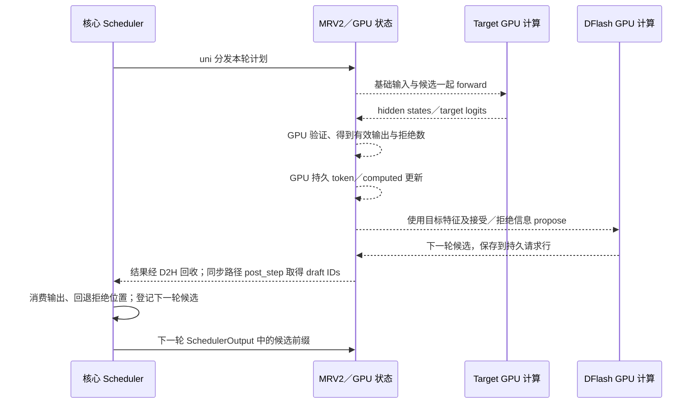

# 第九章：投机解码的一轮验证与状态回退

固定 commit 沿用首页。本章先沿 MRV2、同步调度、单 GPU、greedy 的链式候选讲完整闭环，再定位 DFlash 的草稿构造与现有预算策略。随机采样和异步是明确分开的扩展，不能用概念流程替代算法证明。

## 1. 本章要回答的问题

1. draft 在哪一轮产生，如何成为下一轮 target 的输入？
2. 验证三个候选为什么通常还需要一个基础输入位置？
3. 接受前缀、纠正 token 和 bonus token 各是什么？
4. 拒绝后目标侧、草稿侧与 CPU 请求账本如何重新对齐？
5. 当前源码已经有哪些动态预算能力，研究应从什么缺口入手？

## 2. 先建立直观理解

**草稿（draft）**先提出一段可能的后续 token；**验证（verify）**用目标模型检查这段提议；**接受／拒绝（accept/reject）**决定多少前缀可以真正提交给用户。主线中 greedy 的接受条件是草稿 token 与目标模型同一条件上下文下的 argmax 一致。

如果第一候选正确、第二候选错误，不能跳过第二个只保留第三个。第三个是按包含错误第二个 token 的上下文预测的，因果上下文已经变了。系统提交正确前缀，再提交目标模型给出的纠正 token。若所有候选都通过，还能从最后候选位置的目标预测得到额外的 bonus token。

这使“一次 forward 计算多个位置”有机会推进多个输出，但草稿、验证、选择、KV 状态处理都有成本；接受率只是成本收益分析的一项输入。

## 3. 与 nano-vLLM 的对应关系

已有普通 decode 可看作每轮只有一个新计算位置、提交一个新输出的特例。投机把它扩展为基础位置加多个候选，并引入“安排过但不能计入有效历史”的拒绝位置。不要只把 sampler 换掉：Scheduler 的候选长度、Runner 输入、目标 KV、草稿状态、输出长度都要一起满足契约。

## 4. 源码阅读地图

| 顺序 | 路径与符号 | 为什么读 |
| --- | --- | --- |
| 1 | [vllm/v1/worker/gpu/spec_decode/\_\_init\_\_.py:8](../../vllm/v1/worker/gpu/spec_decode/__init__.py#L8)，`init_speculator` | 确认方法与 draft architecture 的真实分支，DFlash2 另有实现 |
| 2 | [vllm/v1/worker/gpu/model_runner.py:1896](../../vllm/v1/worker/gpu/model_runner.py#L1896)，`sample_tokens`；第 2020 行 `speculator.propose` | 当前 target 输出如何产生下一轮候选 |
| 3 | [vllm/v1/engine/core.py:640](../../vllm/v1/engine/core.py#L640)，`post_step` | 同步时从执行器取得 draft IDs 并更新 Scheduler |
| 4 | [vllm/v1/core/sched/scheduler.py:765](../../vllm/v1/core/sched/scheduler.py#L765)，候选安排分支 | 按本轮预算选择候选前缀，写 scheduled_spec_decode_tokens |
| 5 | [vllm/v1/worker/gpu/model_runner.py:1202](../../vllm/v1/worker/gpu/model_runner.py#L1202)，`prepare_inputs` | 把已采样 token 与候选组成 target 验证输入 |
| 6 | [vllm/v1/worker/gpu/spec_decode/rejection_sampler.py:260](../../vllm/v1/worker/gpu/spec_decode/rejection_sampler.py#L260)，`RejectionSampler.__call__` | 目标 logits、候选位置、有效采样数的接口 |
| 7 | [vllm/v1/worker/gpu/spec_decode/rejection_sampler_utils.py:484](../../vllm/v1/worker/gpu/spec_decode/rejection_sampler_utils.py#L484)，`_rejection_kernel`；第 924 行 `rejection_sample` | 精读 greedy 分支，随机分支另做论证 |
| 8 | [vllm/v1/worker/gpu/input_batch.py:540](../../vllm/v1/worker/gpu/input_batch.py#L540)，`_post_update_kernel`；[vllm/v1/core/sched/scheduler.py:1934](../../vllm/v1/core/sched/scheduler.py#L1934)，拒绝计数处理 | GPU 持久进度和 CPU 预记账分别回退 |
| 9 | [vllm/v1/worker/gpu/spec_decode/dflash/speculator.py:323](../../vllm/v1/worker/gpu/spec_decode/dflash/speculator.py#L323)，`DFlashSpeculator.propose` | 输入含目标 hidden states、接受／拒绝数和最近采样 token |

MRV1 的 `vllm/v1/spec_decode/` 与 `vllm/v1/sample/rejection_sampler.py` 是其他分支的阅读入口；本章主链使用 `worker/gpu/spec_decode/`，不能因名称相似就替换节点。

## 5. 真实闭环：从本轮结果到下一轮验证



图中虚线标设备工作／结果回收，CPU 对 GPU 的发起不是 Python 跨进程调用。当前 uni 下 C 与 R 都在核心进程；面向用户的结果还要经过核心输出队列和 ZMQ 回前端。

实际 `AsyncOutput` 复制可以和 propose 重叠；图按数据依赖解释，不声称这些工作严格串行。当前同步 Scheduler 在 post_step 取得候选，异步路径不先取实际 IDs，由 Worker 保存并消费设备上的候选、核心用占位进度；证据在 `EngineCore.post_step` 的条件分支。

### DFlash 不是逐 token 草稿循环的简单改名

**源码事实：**DFlashSpeculator 在 propose 中准备目标特征／上下文，再调用 `precompute_and_store_context_kv`，见 [vllm/v1/worker/gpu/spec_decode/dflash/speculator.py:427](../../vllm/v1/worker/gpu/spec_decode/dflash/speculator.py#L427)；其固定 query 结构还有独立 graph dispatch。目标验证 graph 和草稿 graph 不是同一个对象。

**设计解释：**草稿计算有自己的状态和形状。只在 target 输入处裁剪候选，不能推导这一轮已经完成的草稿计算也省掉；要区分“少生成”和“生成后少验证”。本章不假定任意 target 都有可用 DFlash 权重，具体匹配和训练长度必须核实本地模型配置。

## 6. 关键源码精读

### 6.1 同步路径把下一轮候选交给 Scheduler

<!-- source: vllm/v1/engine/core.py:644-647 -->

```python
if self.check_for_draft_tokens and not self.async_scheduling and model_executed:
    draft_token_ids = self.model_executor.take_draft_token_ids()
    if draft_token_ids is not None:
        self.scheduler.update_draft_token_ids(draft_token_ids)
```

输入是本轮执行后 Worker 持有的下一轮草稿；输出通过修改 Scheduler 的请求候选状态体现，不是立即对用户提交。下轮 `schedule` 可按预算裁短。不能把“草稿已经产生”当成“已经验证通过”。

### 6.2 greedy 接受条件对应前缀

`_rejection_kernel` 的非 synthetic 分支：

<!-- source: vllm/v1/worker/gpu/spec_decode/rejection_sampler_utils.py:586-594 -->

```python
else:
    accepted = target_argmax == draft_sampled
accepted &= is_valid_draft
verifying = accepted
accepted_length += accepted
tl.store(
    sampled_ptr + req_idx * sampled_stride + i,
    draft_sampled if accepted else target_argmax,
)
```

输入是目标 argmax 与对应草稿 ID，placeholder 无效草稿必须拒绝；输出写到采样结果张量。verifying 一旦变 False，后面候选不继续作为合法前缀接受。第一次不匹配时写入 target_argmax 作为纠正 token。外层循环、bonus／resampling 分支也要连读，这段只是 greedy 核心判断，不是完整算法伪装成几行。

### 6.3 CPU 预记账扣掉拒绝位置

<!-- source: vllm/v1/core/sched/scheduler.py:1940-1943 -->

```python
num_draft_tokens = len(scheduled_spec_token_ids)
num_sampled = self.num_sampled_tokens_per_step
num_accepted = max(len(generated_token_ids) - num_sampled, 0)
num_rejected = num_draft_tokens - num_accepted
```

输入是实际安排的候选和返回有效输出长度；普通 AR 的基础采样数为 1，所以提交长度通常是接受候选数加一个纠正／bonus。后续非 stale 分支从 computed 减去 num_rejected，异步还需修正 placeholders。它不意味着立刻逐个释放 GPU KV 槽位。

Worker 侧 `_post_update_kernel` 使用 `computed_delta = query_len - num_rejected` 推进持久计算进度，并更新 last_sampled_tokens／all_token_ids。propose 又得到 num_sampled、num_rejected，因此草稿侧不能继续使用已拒绝的历史作为有效上下文。**设计解释：**回退首先是有效边界与下一次输入的修正；容量可以仍保留，错误后缀未来被合法重写，不能一律要求立即释放物理块。

## 7. 贯穿案例：接受一个、拒绝后缀

**教学示例，非运行结果。**R 的 prompt 长 4，上一轮已提交 55；computed=4、已知总长=5。新草稿为 `[66,77,88]`，输出上限足够，target 在真实条件前缀上的下一 token 先是 66，随后是 99。

| 步骤 | 内容 | 进度／KV |
| --- | --- | --- |
| 安排验证 | 输入 `[55,66,77,88]`，逻辑 positions 4—7 | 基础位置 1 + 候选 3；CPU computed 预记为 8 |
| 检查候选 66 | 基于历史+55 的 target argmax=66 | 接受，66 在 position 5 的 KV 可成为有效历史 |
| 检查候选 77 | 基于历史+55+66 的 target argmax=99 | 拒绝 77，后面的 88 也不能提交 |
| 提交 | 新输出 `[66,99]` | 接受候选数 1，纠正 token 数 1，总推进 2 |
| 回退 | rejected=3−1=2 | computed 从 8 回到 6；有效 KV 截止 position 5 |
| 下一轮 | 99 是新的基础输入，追加下一批候选 | 99 的有效 KV 尚未计算；错误后缀位置将被覆盖 |

如果三个候选全部通过，本轮能提交三个候选加一个 bonus。若第一个就拒绝，本轮只提交纠正 token，仍需承担草稿与验证开销。即使接受率不错，也可能因为 padding、草稿成本或 CPU 同步而不如普通 AR。

## 8. 动手实验与预算研究入口

__已验证__：本章源代码路径、摘录和既有能力位置。__未运行__：DFlash 模型、GPU 验证、接受率或性能测量；也未核查外部论文／PR 的最新状态，不在这里作原创性判断。

先使用无需模型的源码检索：

```powershell
rg -n 'take_draft_token_ids|update_draft_token_ids|num_spec_tokens_to_schedule' vllm/v1/engine/core.py vllm/v1/core/sched/scheduler.py
rg -n 'num_rejected|target_argmax == draft_sampled|computed_delta' vllm/v1/worker/gpu/spec_decode/rejection_sampler_utils.py vllm/v1/worker/gpu/input_batch.py
```

__仅提供步骤__：测试依赖与 CUDA 可用时，先运行当前 MRV2 相关验证与 DFlash 输入准备测试，再进行完整模型评测：

```bash
uv run --no-project --offline --python .venv/bin/python python -m pytest tests/v1/spec_decode/test_rejection_sampler_utils.py tests/v1/spec_decode/test_dflash_prepare_inputs.py -q
```

__仅提供步骤的最小模型实验程序__如下；这是学习用程序，非源码摘录。必须先准备匹配的本地 target／DFlash 快照，记录 revision，确认所选 K 与草稿配置相容且显存足够。第一章的 OPT 模型不是这里默认可用的 DFlash target。

```bash
export HF_HUB_OFFLINE=1
export VLLM_USE_V2_MODEL_RUNNER=1
export VLLM_ENABLE_V1_MULTIPROCESSING=1
export TARGET_MODEL=/absolute/path/to/matched/target
export DRAFT_MODEL=/absolute/path/to/matched/dflash
export K=3  # 教学值；执行前按本地模型兼容配置修改
uv run --no-project --offline --python .venv/bin/python python - "$TARGET_MODEL" "$DRAFT_MODEL" "$K" <<'PY'
import sys
from pathlib import Path
from vllm import LLM, SamplingParams

target, draft = (Path(p).resolve() for p in sys.argv[1:3])
assert target.is_dir() and draft.is_dir(), "需要已有本地模型目录"
llm = LLM(
    model=str(target), spec_method="dflash", spec_model=str(draft),
    spec_tokens=int(sys.argv[3]), tensor_parallel_size=1,
    distributed_executor_backend="uni", async_scheduling=False,
    enforce_eager=True, enable_prefix_caching=False,
    max_model_len=256, max_num_batched_tokens=128, max_num_seqs=1,
    gpu_memory_utilization=0.8, seed=0,
)
for result in llm.generate(["Explain what a KV cache stores."],
                           SamplingParams(temperature=0, max_tokens=16),
                           use_tqdm=False):
    print(result.prompt_token_ids, result.outputs[0].token_ids)
PY
```

观察点：先建立同 target、相同输入的 AR token 基线，再在独立实例运行 DFlash。只看最终文本不足以验证每个 token；不一致时记录首个差异、配置和停止原因。本程序不输出逐轮接受长度，不能把输出列表当成接受率日志。

### 当前源码已有的两类预算能力

| 能力 | 精确入口 | 当前能确认什么 |
| --- | --- | --- |
| Dynamic SD | [vllm/v1/spec_decode/dynamic/utils.py:77](../../vllm/v1/spec_decode/dynamic/utils.py#L77)，`build_dynamic_sd_schedule_lookup`；Scheduler 第 1355 行 | 把 batch-size 区间配置展开成 K 查表；不等于按每请求置信度分配同轮预算 |
| Adaptive Verification | [vllm/v1/worker/gpu/spec_decode/adaptive_verification.py:269](../../vllm/v1/worker/gpu/spec_decode/adaptive_verification.py#L269)，`get_num_tokens`；第 379 行 `reallocate_drafts` | 结合历史置信度和成本表选总预算，再分配／压紧候选，改变本轮有效输入 |
| 能力限制 | [vllm/config/speculative.py:1519](../../vllm/config/speculative.py#L1519)，配置校验 | 此 commit 的 enable_adaptive_verification 限 DSpark，不能给 DFlash 直接打开并宣称可用 |

Adaptive Verification 的预算估计会读取已经复制回来的旧置信度，避免把当前验证后才知道的真实接受率用作当前决策；GPU 重分配又使用当前设备置信度。它还有 backend 对 query 长度语义与图能力的校验，入口见同文件第 440 行。研究时要把决策点、数据新鲜度、压紧成本和图形状一起检查。

无 GPU 替代练习：对两个请求分别给候选置信度，手算总预算 3 的前缀分配；说明候选前缀闭合、tie、NaN、剩余长度和请求重排应怎样处理。这是策略设计练习，不是当前源码运行结果。进一步改代码前先调查已有实现与研究，并明确目标是减少 draft、verify 还是排队成本。

## 9. 易错点与自我检验

1. 验证输入 `[55,66,77,88]` 的四个位置与三个候选怎样对应？
2. 第二候选拒绝后，为什么第三候选即使数值碰巧正确也不能跳着提交？
3. 新提交 99 是否立即拥有正确 KV？
4. 拒绝后为什么既要更新 CPU computed，又要更新 Worker 状态？
5. 同步和异步的候选 ID 交接区别在哪里？
6. greedy token 一致性是否证明随机采样无偏？
7. 当前 DFlash 能否直接启用 DSpark 的 Adaptive Verification 开关？
8. 提高接受率为什么不必然提高吞吐？

## 10. 本章总结

现在应能沿真实 MRV2 链路解释 draft→下一轮 target 验证→接受／拒绝→CPU／GPU 进度修正→下一轮草稿，手算纠正 token 和 KV 有效边界，并定位两种既有预算能力。尚未证明随机自适应裁剪的分布正确性，也未完成 DFlash 运行复现或外部研究查新。

下一章把这些假设变成可检验实验：先做不改业务源码的小规模配置对照，产出可复用记录和输出比较；以后再将单一代码决策点替换为真实优化，并保持同样的证据标准。

### 自我检验答案

1. 55 是上轮已提交但尚未计算 KV 的基础输入，后三个是候选；target 在各位置预测下一 token。
2. 后续预测依赖已经错误的前缀，必须保留前缀闭合并在首次错误处纠正。
3. 没有，position 6 此前输入是错误的 77；下一轮要输入 99 重写有效位置。
4. 两边各有状态与预记账；只改一边会导致后续输入、位置或预算失配。
5. 同步 post_step 取回候选并更新 Scheduler；异步主要由 Worker 保存真实候选，CPU 使用占位协议。
6. 不证明。随机分支需要 proposal／target 分布、接受与重采样正确性；自适应裁剪还要单独分析。
7. 不能，当前配置显式限制 method=dspark。
8. 成本包括 draft、target、选择、输入打包、同步和状态处理，且图 padding 与负载会改变真实工作量。
